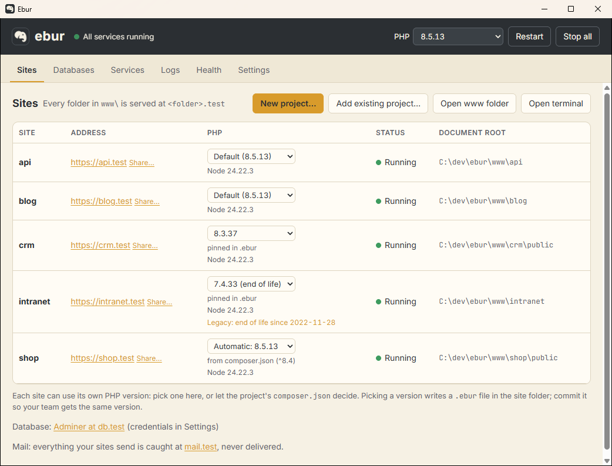
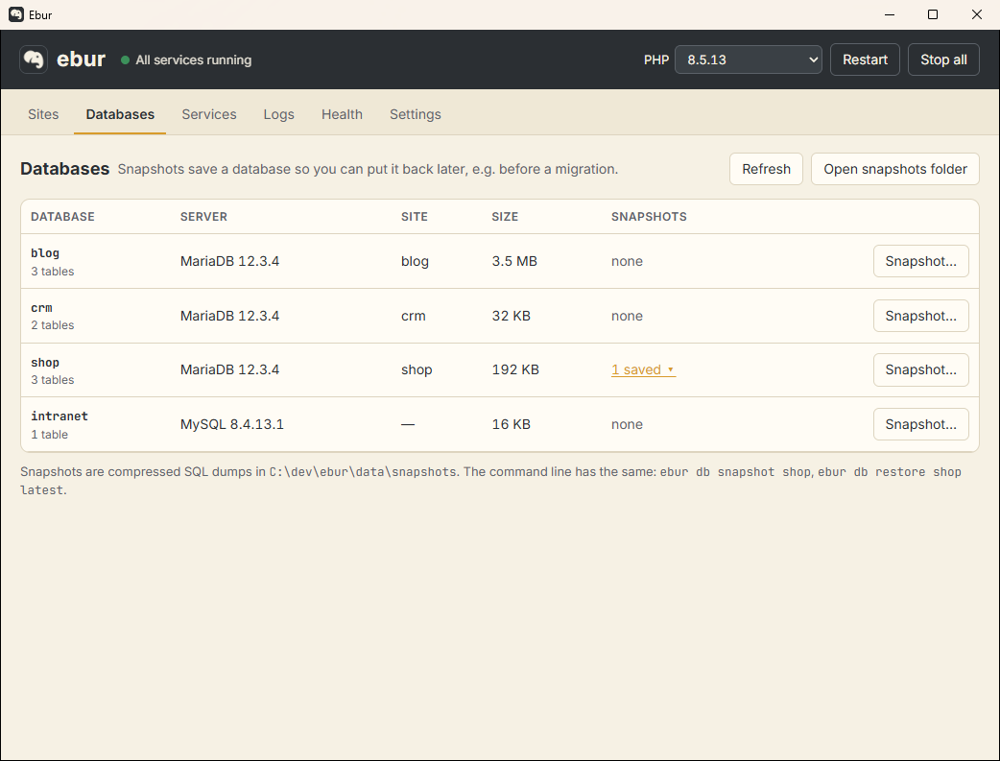
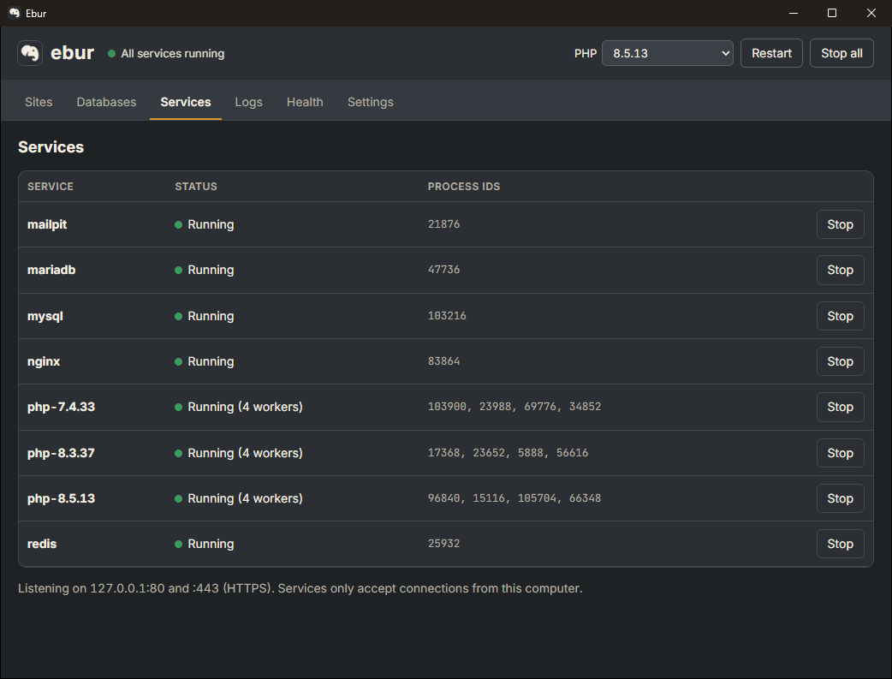

<p align="center">
  
</p>

<h1 align="center">Ebur</h1>

<p align="center">
  A free, open-source local PHP development environment for Windows.<br>
  One folder, one tray app, one command line.
</p>

---

<picture>
  <source media="(prefers-color-scheme: dark)" srcset="docs/screenshots/sites-dark.png">
  
</picture>

Ebur runs PHP, Nginx, MariaDB or MySQL, Redis and Node.js on your computer.
Every folder you put in `www\` is served at `https://<folder>.test` (or
`.localhost`), with a trusted local certificate. It downloads official
builds, checks every download's SHA-256, and keeps everything in one folder.

> **Status: early development (0.1.0-dev).** Windows 10 21H2+ and Windows 11,
> x64. Builds are not code-signed yet, so Windows SmartScreen and the
> administrator prompt will show "Unknown publisher". macOS and Linux are
> planned for v2.

## What it does today

- **Sites:** every folder in `www\` is served at `<folder>.test`; Laravel and
  Symfony `public\` folders are detected. New or removed folders, and changes
  to a site's PHP version, apply within about two seconds, without a restart.
- **PHP 8.2 to 8.6, plus legacy 7.4, 8.0 and 8.1 for old projects** (clearly
  marked as end of life), **per project:** each site can run its own PHP version at
  the same time, chosen by a `.ebur` file (`php: "8.3"`) or the PHP
  requirement in its `composer.json`; everything else uses the default,
  which you switch in one click. PHP runs as a pool of workers, so a slow
  request does not block others.
- **MariaDB and MySQL** (8.4 LTS, plus legacy 8.0 and 5.7), side by side on
  their own ports, with generated root passwords and **Adminer** at
  `db.test`. **Snapshots** save a database before a risky migration and put
  it back in one click.
- **New projects:** Laravel, WordPress or Symfony in one step, each with its
  own database; `ebur link` serves a project that lives outside `www\`.
- **Node.js** per project (from `.nvmrc` or `package.json`), so Vite and npm
  work in Ebur's terminal; **Redis** with PHP's redis extension.
- **Share links:** a temporary public `https://` address for showing a site
  to a client or testing on a phone; it ends after an hour.
- **Mail capture:** every email your sites send (password resets, sign-ups)
  lands in a local inbox at `mail.test` (Mailpit) and never reaches real
  people. PHP's `mail()` works with no setup; `ebur mail` shows the Laravel
  and Symfony settings.
- **Local HTTPS:** Ebur's own certificate authority, limited to `.test` and
  `localhost` names, so its key cannot be used to impersonate real sites.
- **Composer** included; a terminal with PHP, Composer, Node and the
  database clients on `PATH`, without changing the system `PATH`.
- **Tray app and window** (Sites, Services, Logs, Health, Settings), light or
  dark, and a first-run wizard.
- **Full command line**: everything the window does, `ebur` does too.
- **`ebur doctor`** checks ports, runtimes, configs and the hosts file, and
  says how to fix what it finds.

| Databases: MariaDB and MySQL side by side, with snapshots | Services: three PHP versions running at once |
| --- | --- |
|  |  |

## Quick start

1. Run the installer (or unzip the portable build into `C:\ebur`).
2. Ebur opens with a short setup: pick a PHP version, a database and HTTPS.
3. Create `C:\ebur\www\shop\index.php` and open `https://shop.test`.

Windows asks for permission twice during setup: once to trust Ebur's
certificate, once to add your site names to the hosts file. Some security
software (for example Webroot) blocks hosts-file changes; `ebur doctor`
explains what to allow.

## Command line

```
ebur setup                  first-run setup (same as the window's wizard)
ebur start | stop | restart all services, or name one: nginx, php, mariadb, mysql, redis
ebur status                 what is running, and the site URLs
ebur php 8.4                switch the default PHP; restarts in about a second
ebur sites php shop 8.3     pin one site's PHP (writes www\shop\.ebur)
ebur php install 8.3        add another PHP version
ebur node install 24        add Node.js (npm, Vite); a site's .nvmrc or package.json picks its version
ebur sites                  list sites
ebur new shop --laravel     new Laravel site with its own database (also --wordpress, --symfony)
ebur link D:\code\shop      serve a project outside www\ (ebur unlink shop undoes it)
ebur db                     database credentials and an .env snippet
ebur db snapshot shop       save shop's database (ebur db restore shop latest puts it back)
ebur share shop             temporary public https:// link for a client or phone (ends after 1 h)
ebur mail                   where caught mail goes, and .env settings
ebur install redis          Redis on 127.0.0.1:6379, with PHP's redis extension
ebur install mysql 8.4      MySQL next to MariaDB, on its own port (also 8.0, 5.7)
ebur db default mysql       new projects use MySQL (or: ebur new shop --laravel --db mysql)
ebur ssl install            local HTTPS (ssl uninstall removes it)
ebur hosts sync             map site names to 127.0.0.1
ebur tld localhost          sites at <name>.localhost: no hosts file needed (for locked-down PCs)
ebur exec composer install  run a command with Ebur's PHP and Composer
ebur terminal               open a console with Ebur's tools on PATH
ebur doctor                 find and explain problems
ebur status --json          machine-readable output (also sites, doctor, db, db list, db snapshots, share, php/node list)
```

## Build from source

Requirements: Go 1.27+, Node.js 22+, and optionally
[Inno Setup 6](https://jrsoftware.org/isinfo.php) for the installer.

```
powershell -ExecutionPolicy Bypass -File build\build.ps1 -Version 0.1.0-dev
```

This builds the window's frontend, runs the tests, builds `ebur.exe` (CLI),
`ebur-app.exe` (tray app) and `ebur-helper.exe` (the only part that runs as
administrator, for the hosts file), and writes a portable zip and the
installer to `dist\`.

For quick development builds, see [app/README.md](app/README.md).

## How it is built

| Folder | What it holds |
| --- | --- |
| `core/` | All logic, in Go: runtimes, supervisor, sites, certificates, setup |
| `cli/` | The `ebur` command (thin layer over `core`) |
| `app/` | Tray app and window: Wails v3 with a Svelte frontend |
| `helper/` | `ebur-helper.exe`, the elevated hosts-file editor |
| `manifest/` | Runtime versions, download URLs and SHA-256 checksums |
| `build/` | Release script and installer definition |
| `spikes/` | Early feasibility experiments, kept for reference |

The requirements, decisions and known risks are in the
[Software Requirements Specification](Ebur%20%E2%80%94%20Software%20Requirements%20Specification.md).
Requirement IDs such as `SITE-02` appear in code comments, issues and commits.

## Keeping runtime versions current

`manifest/runtimes.json` lists every PHP, Node, database and tool version
Ebur offers, with its download URL and SHA-256. A daily job
(`.github/workflows/manifest-update.yml`) checks the official sources and
opens a pull request when a newer version passes the rules: at least 14 days
old unless it is a security release, Node LTS lines only, checksums from the
vendor. MySQL, MariaDB and Nginx updates are listed for a manual update.
Run the same check locally with `go run ./build/manifest-update` (add
`-write` to update the file).

When the manifest changes on `main`, `.github/workflows/publish-manifest.yml`
signs it (Ed25519, key in the `MANIFEST_SIGNING_KEY` secret) and publishes
it on the `manifest` release. Installed copies check it daily and use it
only if the signature matches the public key built into Ebur and it is
newer than their own, so new versions and security fixes arrive without a
new Ebur release. That check is a plain HTTPS request to GitHub with no
identifier; `"manifest_url": "off"` in `ebur.json` turns it off, and
`ebur manifest` shows which list is in use.

## Releases and download counts

Pushing a version tag publishes a release: GitHub Actions runs the tests,
builds the installer and portable zip with that version, and attaches them
with a `SHA256SUMS.txt` (`.github/workflows/release.yml`).

```
git tag v0.1.0
git push origin v0.1.0          # a tag like v0.2.0-beta.1 becomes a pre-release
```

Ebur sends no telemetry (NFR-17). GitHub counts how often each release file
is downloaded:

```
gh api repos/ebur-dev/ebur/releases --jq ".[] | {tag: .tag_name, downloads: [.assets[] | {(.name): .download_count}]}"
```

Without the GitHub CLI (PowerShell; works once the repository is public):

```
(Invoke-RestMethod https://api.github.com/repos/ebur-dev/ebur/releases) | ForEach-Object { $_.tag_name; $_.assets | Format-Table name, download_count }
```

## Contributing

Issues and pull requests are welcome. Please reference the requirement ID
your change touches, and run `go test ./...` before sending a pull request.

## Licence

MIT, see [LICENSE](LICENSE). PHP, Nginx, MariaDB and the other tools Ebur
downloads keep their own licences; see [THIRD_PARTY.md](THIRD_PARTY.md).
